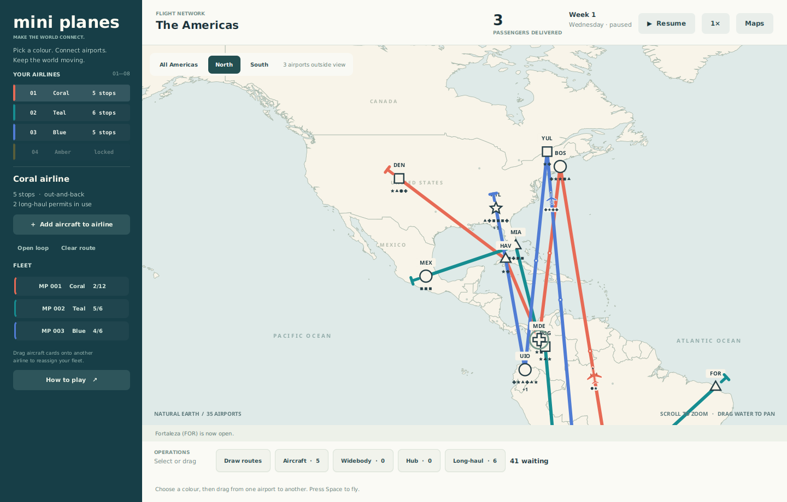

# Mini Planes

A JavaFX strategy game about building an airline network. Connect growing airports, carry passengers to matching symbols, arrange transfers and survive overcrowding. Developed from the original Mini Planes prototype, with its airport, aircraft and route model separated into MVVM layers.



**Two maps, 70 airports:** Europe and the Americas, with country borders and real airport coordinates. Straight routes support up to four separated parallel airlines, endpoint editing, stop insertion/reordering and loops. Grow your fleet with weekly rewards, widebody upgrades, hub terminals and long-haul permits. Aircraft are crisp vectors in their airline’s colour and scale with zoom; onboard destination symbols travel with each aircraft.

## Run on Linux

Install **JDK 21**, **Maven 3.9+** and **GTK 3**. In this directory:

```sh
mvn clean verify
mvn javafx:run
```

Maven downloads JavaFX and the other dependencies on the first run. The game then uses bundled maps and needs no network connection.

## Controls

Choose a colour and drag between airports. Drag the always-visible T handles to extend a route; passing over a terminal removes it. Drag a segment through an airport to insert/reorder a stop, or join the ends to make a loop. Right-click a stop to remove it from the selected route. Resources can be selected and applied, or dragged onto the map. Drag fleet cards onto another route to move aircraft; new aircraft start at the first airport.

**Space** pause · **1/2/3** speed · **Q/E** airline · **Esc** cancel · **Delete** clear route · **H** help · **R** reset camera. Scroll to zoom; drag empty space or Shift-drag to pan. The Americas have North, South and overview camera presets, with a counter for airports outside the view. Start paused, build a route, then resume. The in-game guide explains capacity, upgrades and scoring.

## Code and tests

`model` contains the deterministic simulation, routing and geometry, with no JavaFX dependencies. `viewmodel` exposes observable state and transactional commands; `view` handles controls, input and rendering. JSON catalogs and vector map data live in `src/main/resources`. JUnit covers transfers, passenger conservation, resource refunds, overcrowding, route editing and parallel geometry. Optional UI checks: `xvfb-run -a mvn -Dminiplanes.ui=true verify` (requires Xvfb).

Code: [MIT](LICENSE). Geography and airport sources: [NOTICE](NOTICE). This is an independent game inspired by network-building games; it is not affiliated with Mini Metro or its creators.
